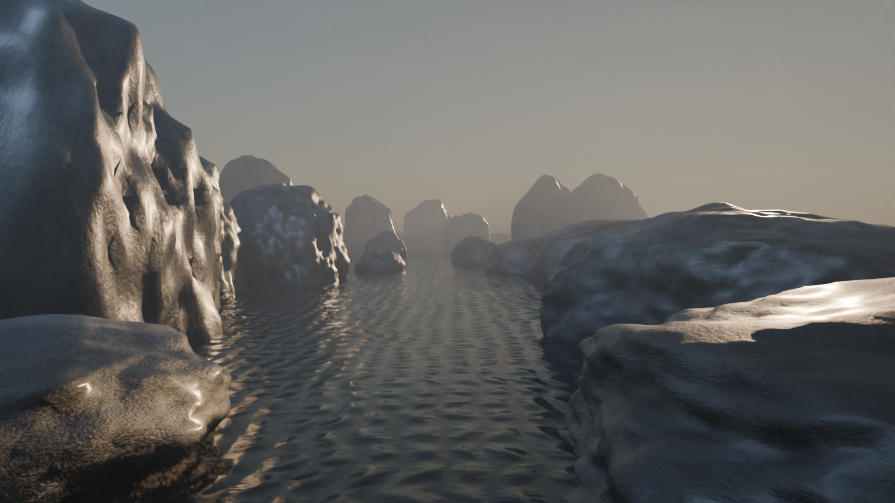

# TIDELIGHT

TIDELIGHT is a reproducible scene study about turning explicit equations into
an image, then checking whether a known scene's parameters can be recovered
from its rendered pixels. It has two related parts:

1. a fixed, three-parameter inverse-rendering experiment; and
2. a separate cinematic extension with a moving water surface, drifting
   procedural mist, wet foreground stone and a slow camera rail.

The cinematic extension is an authored procedural scene rendered offline with
Blender Cycles. It is not a fluid solver, a general-purpose renderer, or a
claim that an arbitrary photograph can be reconstructed from pixels.



**See it:** [original experiment](https://www.xn--arkh-eva.org/tidelight/) ·
[cinematic motion study](https://www.xn--arkh-eva.org/tidelight/motion/) ·
[annotated film (MP4)](https://www.xn--arkh-eva.org/tidelight/motion/tidelight-motion-and-math.mp4)

## What is in this repository

- `scene.py` — the preserved procedural inlet used by the inverse experiment.
- `recovery.py`, `render_service.py`, `evaluate.py` — the bounded fitting
  protocol and Blender render queue.
- `PROTOCOL.md`, `RESULTS.json`, `VERIFICATION.json` — the experiment's frozen
  settings and receipts.
- `cinematic-shot/shot_scene.py` — the motion extension. It imports the
  preserved scene and adds deterministic water, mist, wet-stone and camera
  motion without rewriting the parent source.
- `cinematic-shot/verify_motion.py` — independent state checks, including a
  vectorized four-wave comparison and exact rewind/control checks.
- `cinematic-shot/render_shot.py` and `cinematic-shot/compose_film.py` — frame
  rendering and film assembly.
- `website/dist/tidelight/` — the local copy of the explanatory web page and
  both the original experiment and cinematic motion pages. A standalone
  source preview also lives in `cinematic-shot/`.
- `docs/MATH.md` — the equations, constants, units note and claim boundary.
- `docs/VERIFICATION.md` — repository checks and a fresh full recovery replay.

This repository intentionally does not include the large rendered PNG
sequence or MP4 files. The public review page supplies those films; the
scripts here rebuild the scene and its checks.

## How the scene is described

The moving surface is a sum of four traveling waves:

$$
\eta(x,y,t)=\sum_{i=1}^{4}A_i\sin(k_{x,i}x+k_{y,i}y-\sqrt{9.81\|\mathbf{k}_i\|}(0.42t)+\phi_i).
$$

| Ingredient | Rule | What it controls |
| --- | --- | --- |
| Water | Four sine terms with fixed amplitudes, wavevectors and phases | Actual water mesh heights at each frame |
| Mist | Translated 3D noise multiplied by a height falloff | Volume density in the light |
| Wet stone | World-height maps to roughness and coat weight | The two added foreground stones' shading |
| Camera | Smoothstep interpolation along an authored rail | Position, look-at target and focus distance |

These are designed visual rules. No pressure/velocity solver advances the
water, no fluid simulation transports the mist, and the stones do not displace
the water. The coefficients and full equations are in [docs/MATH.md](docs/MATH.md).
The original still experiment uses its own three-wave surface; the cinematic
extension replaces the mesh height with the four-wave motion above.

## Results at a glance

The original inverse test uses three known scene parameters and three sampled
target settings, with separate held-out camera and light-edit views. Cases A and C meet the declared parameter and image-fit thresholds;
case B improves the image but misses the parameter-accuracy threshold. That is
the recorded mixed result, not a universal inverse-graphics claim. See
[`RESULTS.json`](RESULTS.json) and [`docs/ORIGINAL_PACKAGE.md`](docs/ORIGINAL_PACKAGE.md).

The cinematic shot is 10 seconds at 24 fps: 240 individually rendered
1600×900 Cycles frames, assembled into a silent film. The 50-second math film
replays that same shot while revealing the four wave terms, mist field,
wetness map and camera rail. It does not interpolate frames or pretend that
the browser is rerendering the Blender scene.

## Reproduce the source checks

Create the host-Python environment and install the pinned numerical/compositor
dependencies:

```sh
python3 -m venv .venv
source .venv/bin/activate
python -m pip install -r requirements.txt
```

Commands below start at the repository root unless noted. Run the lightweight source and inverse checks:

```sh
python scripts/verify_sources.py
python recovery_tests.py
python scripts/test_asset_fetch.py
```

`scripts/fetch_assets.py` can fetch the declared seven review assets for a
complete local preview (57.7 MB downloaded, with SHA-256 verification; no API key):

```sh
python scripts/fetch_assets.py
python website/preview.py --port 8767
```

Then open `http://127.0.0.1:8767/tidelight/` or
`http://127.0.0.1:8767/tidelight/motion/`. The preview server is loopback-only.

### Reproduce the cinematic checks

Install Blender 5.1.2 separately. Its bundled Python is distinct from the
host-Python environment above. Set its executable, then run the no-render
motion verifier:

```sh
BLENDER="$(command -v blender)"  # when Blender is on PATH
# On macOS with the standard app install, use this instead:
# BLENDER=/Applications/Blender.app/Contents/MacOS/Blender
```

```sh
cd cinematic-shot
"$BLENDER" --background --factory-startup --python verify_motion.py
```

The verifier rebuilds the scene, samples several times, rewinds the clock,
tests nearest no-motion controls and compares all 21,901 water vertices with
an independent vectorized implementation of the four-wave equation.

Still in `cinematic-shot/`, render one preview frame:

```sh
"$BLENDER" --background --factory-startup --python render_shot.py -- \
  --frame 120 --width 960 --height 540 --samples 24 \
  --output previews/check-0120.png
```

The complete render is deliberately opt-in:

```sh
"$BLENDER" --background --factory-startup --python render_shot.py -- \
  --movie --width 1600 --height 900 --samples 24
```

On the recorded M1 Max run, the 240-frame render took 4,749.034911 seconds
(79m09s). That is a local measurement, not a runtime guarantee. Assemble the
films with the portable wrapper after returning to the repository root:

```sh
cd ..
python scripts/compose_film.py --ffmpeg /path/to/ffmpeg \
  --font /path/to/font.ttf
```

The wrapper defaults to the system `ffmpeg` and a local Arial/DejaVu fallback
when those options are omitted. A different font changes annotation layout but
not the rendered scene.

### Reproduce the original inverse experiment

From the repository root, the full fit starts a persistent Blender render
service and writes a fresh replay. It used about five minutes on the recorded
machine; other hardware can take substantially longer. Use the host Python
from the activated environment and the Blender executable set above:

```sh
CINEMATIC_BLENDER="$BLENDER" \
CINEMATIC_PYTHON="$(command -v python)" \
  zsh reproduce.sh
```

The launcher writes a timestamped `replays/` directory and preserves the
first-attempt logs and results. It does not overwrite the frozen
`RESULTS.json`. A fresh packaging replay retained the same A/C pass, B fail
outcome with different fitted values; see [the verification record](docs/VERIFICATION.md).

## Tools

The recorded host was Python 3.9.6 on macOS / Apple M1 Max. The pinned host
dependencies are in `requirements.txt`; other Python/platform combinations
have not been verified here. Renderer selection uses Metal when available and
otherwise falls back to CPU; it does not configure CUDA/OptiX automatically.

The scene and checks were authored and assembled with Codex-assisted Python,
Blender 5.1.2/Cycles with Metal on the recorded macOS run, FFmpeg 8.0.1,
NumPy, SciPy, Pillow and Matplotlib. The explanatory page uses ordinary
HTML/CSS/JavaScript/SVG and a vendored KaTeX 0.19.0 build. The browser page
explains and controls diagrams; it does not run a hidden 3D solver.

## Relationship to ARSENAL

[Countercurrent](https://github.com/AdemVessell/countercurrent) is the stronger
fluid-dynamics example: a bounded linear shallow-water field coupled
reciprocally to one float-heave coordinate. A shared potential drives both
water pressure and float force. Its published checks compare the GPU solver
with a CPU reference and reject a missing-feedback mutation. Its
[model and limits](https://github.com/AdemVessell/countercurrent/blob/main/MODEL.md)
exclude full 3D/nonlinear hydrodynamics, displaced-volume buoyancy and breaking
waves; it is not a general CFD simulator.

[The Cove in ARSENAL's first drop](https://github.com/AdemVessell/arsenal-first-drop)
uses an FFT wind sea plus analytic swell in a browser-native cinematic scene.
Its released numerical checks cover spectral/FFT properties, not measured
sea-state calibration or physical validation of every visual effect.

TIDELIGHT uses neither solver. Its contribution here is the authored cinematic
scene, visible mathematical recipe, bounded inverse experiment and reproducible
checks around Blender Cycles. All three projects use mathematics; their models,
renderers and validated claims differ.

## Scope and rights

The historical `_m` field names in motion metadata describe an assumed scene
scale. They are not a calibration to measured metres. The inverse experiment
uses synthetic images from its own known renderer, not arbitrary photographs;
its withheld labels were separated by process interface on a shared local
filesystem, not by cryptographic isolation. The synthetic labels in
`evaluation-private/truth.json` are now public; its directory name records the
original evaluator boundary, not a current secrecy guarantee.

The procedural source and scene are provided for inspection and reproduction;
no blanket open-source licence is granted by this repository. Blender/Cycles,
KaTeX and the bundled fonts retain their upstream terms. See
[`NOTICE.txt`](NOTICE.txt) and the notices under
[`cinematic-shot/vendor/`](cinematic-shot/vendor/).
